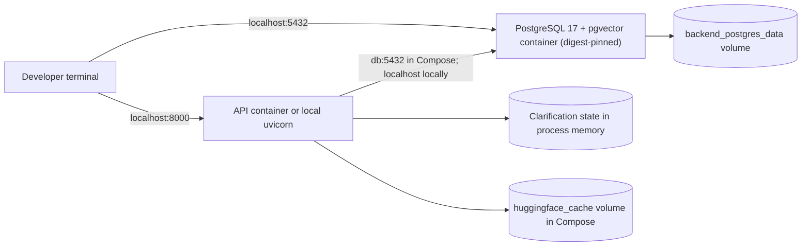

# Current system architecture

Code snapshot: **`main` at `a4422c6`, reviewed 2026-10-11.** Milestone 3
(Phases 1-7 and hardening H0-H8) is closed
(`docs/milestone-3-hardening-plan.md`, "Close-out"). The Milestone 4
design, stored recipes as references rather than answers, was accepted
at Checkpoint E on 2026-10-09 (`docs/adr/0003-references-not-answers.md`)
and is **not implemented**. Fixes for three defects seen in the owner demo
of 2026-10-09 were merged with PR #2 (`docs/milestone-4-plan.md`, D0);
the fourth, cured meats in the raw-protein list, is open. This page
describes implemented behavior. Numbers carry their source; section 7
lists how they were checked. Diagrams use Mermaid, which GitHub renders
directly.

**Reading order:**

1. **[The agent system](agent-system.md):** a one-sitting explanation
   of the agent. It covers the design principles, components, a run
   step by step, context management, memory, human approvals,
   guardrails, security, observability, evaluation and limits.
2. **[Agentic development workflow](agentic-development.md):** how the
   system is built with AI coding agents. It covers roles, guardrails,
   human checkpoints, verification and paid-run governance.
3. This page, which places the agent within the whole backend,
   including ingestion, clarification and retrieval.
4. [Request flows](request-flows.md) and
   [data and ingestion](data-and-ingestion.md).

## 1. The system in plain language

The backend has five main jobs:

1. **Prepare recipe data:** explicit ingestion commands normalize dataset rows,
   optionally ask a model to interpret ambiguous text, validate results, and load PostgreSQL.
2. **Find stored recipes:** API endpoints search both datasets or fetch one canonical recipe.
3. **Clarify a cooking request:** rules and an optional model propose questions;
   typed answers update server-owned, temporary conversation state.
4. **Recommend a stored recipe:** consult Epicure, fetch source evidence, ask a
   bounded model to select, then validate and render recipe facts and propositions
   on the server.
5. **Run the cooking agent (Milestone 3):** a bounded tool-using loop that
   works through a Postgres-backed session from request to cooking plan. It
   asks when an answer matters, waits for the user's dish choice, searches
   the web only with permission, and passes every answer through
   deterministic validators. See [the agent system](agent-system.md).

The agent loop is implemented (`agent/loop.py`, hand-written, no
framework): native function calling over the typed registry, parallel
calls in call order, CAS plus events per step, server-set budgets with
stable stop reasons, Epicure queried by default, validation as the last
gate (see `docs/agent.md` and `docs/adr/0002-agent-loop.md`). Budget
defaults are 12 steps, 12 tool calls, 60k input and 12k output tokens
and 90 s per run (`config.py:143-144`, `:306`, `:320-321`); `make demo`
raises them to 40, 40, 300k, 60k and 240 s (`Makefile:13-23`), and the
H8 live checks ran at those demo limits (`evals/h8_live/PLAN.md:25`). `search_web`
is implemented behind the same registry (server-bound session,
atomic slot claim max 3/session, one bounded hosted sub-request per
dispatch; see `docs/tools.md`). The minimal UI is served at `/ui`
(native ES modules, no build; toggle off by default, backend
enforces; see `docs/ui-walkthrough.md`). Retrieval defaults to
full-text (`RETRIEVAL_MODE` default `fulltext`, ADR 0001). The retrieval
endpoint and the agent's `search_recipes` read that setting; the agent
tool also accepts an explicit `mode` (`fulltext` or `vector`, no hybrid)
from the model on each call (`tools/search_tools.py:115-129`), so with
`EMBEDDINGS_ENABLED=true`, as in `make demo`, the model can run vector
searches whatever the default (it did in H8 attempt 1,
`evals/h8_live/RESULTS.md`). Recommendations keep their own full-text
search.
Clarification readiness feeds the implemented recommendation
workflow (source-grounded selection, backend-only), served over both
non-streaming JSON and versioned SSE streaming (Phase 4, shared
service). Phase 3's ordinary and
native-tool paths have bounded live evidence and owner acceptance based on
AI-assisted review. Structural admission does not certify completeness or
practical usefulness; see [closure and limitations](../phase3-closure.md).

```mermaid
flowchart TB
    Client["Client: curl, Swagger, or /ui page"] --> API["FastAPI backend"]
    API --> Agent["Bounded agent loop (sessions, typed tools, validators)"]
    Agent --> Sessions[("PostgreSQL: sessions + append-only events")]
    Agent --> Recipes
    Agent -->|"LLM_RECOMMENDATION_ENABLED"| AppLLM
    Agent -->|"pairing tools"| Epicure
    Agent -->|"permission on"| WebSearch["Hosted web search"]
    API --> Recipes["Recipe search and lookup"]
    Recipes --> PG[("PostgreSQL: shared recipe corpus")]
    API --> Clarify["Clarification services"]
    Clarify --> Rules["Deterministic question and answer rules"]
    Clarify --> Memory[("Process-local conversation store")]
    Clarify -->|"optional title and ID evidence"| Recipes
    Clarify -->|"LLM_ENABLED"| AppLLM["Interactive application provider"]
    AppLLM --> OpenAI["OpenAI service"]
    API --> Retrieval["Ready-request retrieval"]
    Retrieval --> Memory
    Retrieval --> Recipes
    Retrieval -.->|"vector/hybrid: service and eval harness only"| QueryEmbed["Query embedding"]
    QueryEmbed --> OpenAI
    API --> Recommend["Grounded recommendation service"]
    Recommend --> Memory
    Recommend --> Recipes
    Recommend -->|"cached consultation"| Epicure
    Recommend -->|"LLM_RECOMMENDATION_ENABLED"| AppLLM
    Recommend --> Validation["Validate selection and propositions"]
    Validation --> Render["Server-render source recipe and wording"]
    API --> Pairings["Epicure pairing endpoint"]
    Pairings --> Epicure["Local Epicure vectors"]
    CLI["Operator-run ingestion commands"] --> Parse["Parse, route, validate, merge"]
    Parse -->|"LLM_INGESTION_ENABLED; explicit submit"| Batch["OpenAI Batch extraction"]
    Batch --> OpenAI
    Batch --> Parse
    Parse -->|"explicit load"| PG
    CLI --> Artifacts[("Local data artifacts and manifests")]
    CLI -->|"explicit embedding run"| EmbedCLI["Recipe embedding backfill"]
    EmbedCLI --> OpenAI
    EmbedCLI --> PG
```



Arrows show calls/data flow, not a single execution sequence. The dotted
arrow is a path the HTTP API does not take today. Ingestion and embedding
backfills do not run during API startup. The two LLM paths have different prompts, schemas,
settings and lifecycles. Epicure is a local similarity model, not the LLM.

## 2. Where code belongs

All paths below are relative to `src/culinary_copilot/`.

| Area | Responsibility | Main files |
|---|---|---|
| API | HTTP validation, endpoint dispatch, lifecycle | `api/app.py`, `api/clarification.py`, `api/retrieval.py`, `api/recommendations.py` |
| Retrieval | Ready-request mapping, bounded evidence summaries, retrieval modes (full-text/vector/hybrid, cutoff, gate) | `retrieval/query.py`, `retrieval/service.py`, `retrieval/hybrid.py` |
| Embeddings | Embedding provider, query embedding, model registry, document rendering | `embeddings/provider.py`, `query.py`, `registry.py`, `rendering.py` |
| Recommendations | Grounded selection, Epicure consultation, tool mode | `recommendations/service.py`, `evidence.py`, `policy.py`, `prompts.py`, `propositions.py`, `epicure.py` |
| Domain | Cooking request, questions, answers, status and rules | `domain/requests.py`, `domain/clarification.py`, `domain/recommendations.py`, `domain/rule_planner.py` |
| Services | Planning orchestration, answer updates, concurrency | `services/clarification_service.py`, `hybrid_planner.py`, `answers.py`, `store.py` |
| Application LLM | Async provider interface, fake provider, bounded retries | `llm/client.py` |
| Recipe access | Parameterized SQL search, exact vector search, RRF fusion and document lookup | `recipes/repository.py`, `search.py`, `vector_search.py` |
| Ingestion | Source normalization, extraction, validation and loading | `recipes/import_data.py`, `adapters/`, `llm_batch.py`, `llm_sched.py`, supporting modules |
| Epicure | Load pinned vocabulary/vectors and calculate neighbors (core/cooc/chem) | `tools/epicure.py` |
| Agent tools (M3 Phase 2 + Phase 4 + Phase 5 part 2) | Typed registry, recipe search, Epicure pairings/substitutions, scaling/conversion, technique search, server-bound web search | `tools/registry.py`, `search_tools.py`, `epicure_tools.py`, `measure_tools.py`, `technique_tools.py`, `stub_tools.py` (see `docs/tools.md`, `docs/techniques.md`) |
| Agent loop (M3 Phase 3 + Phase 7 + H0-H8) | Bounded hand-written loop, Epicure-by-default, ask/resume, select/plan, validation last gate, SSE stream; plan quantity attribution | `agent/loop.py`, `agent/validate.py`, `agent/plan_quantities.py`, `api/agent.py` (see `docs/agent.md`, `docs/adr/0002-agent-loop.md`) |
| Web UI (M3 Phase 6) | Static page at `/ui` (no build): message box, streamed stages, options/plan/technique/web cards, question answering, toggle off by default (backend enforces) | `web/` (`index.html`, `demo.html`, `js/`, `styles.css`; see `docs/ui-walkthrough.md`) |
| Infrastructure | Settings, database engine, planning events | `config.py`, `db.py`, `obs/clarification.py` |

Development-only tools are under `scripts/`:
- dataset tools in `scripts/datasets/`;
- the embedding backfill CLI in `scripts/embeddings/embed.py`;
- the technique corpus CLI in `scripts/techniques/` (fetch, load, embed, eval baseline);
- the retrieval evaluation harness in `scripts/retrieval_eval/`;
- the read-only session export in `scripts/sessions/export_session.py`;
- the Milestone 4 corpus-readiness scripts in `scripts/m4/` (read-only).

Live agent runs go through `evals/phase3_agent/live_run.py` (spend
ledger, per-run acknowledgement); the offline agent harness is
`evals/phase7_agent/run.py`.

Production code does not import them. Tests live under `tests/`. `evals/`
holds the frozen retrieval evaluation inputs, the measured full-text
baseline, the Phase 6 development additions and freeze record, and the
recommendation review specs. Recipe-filled results stay local and ignored.

Retrieval measurements so far:
- **Full-text baseline (Phase 2):** Recall@5 0.408 and MRR@5 0.446 over 27
  relevant-labeled units at grade 2. Incomplete judgments and held-out
  exposure limit the claim. See the
  [corrected baseline](../../evals/results/phase1/baseline_fulltext_corrected.md).
- **Phase 6 blind comparison:** 20 adversarial requests, owner-judged.
  - Vector search with a 0.66 cosine-distance cutoff (`vector_c`) won under
    the frozen rule.
  - HitRate@5 was 0.812 against full-text's 0.438.
  - The cutoff returned nothing on all four requests meant to find nothing.
  - The default was not changed. See the [scoreboard](../scoreboard.md) and
    [ADR 0001](../adr/0001-retrieval-default.md).

## 3. Deployment and lifetime



- Compose runs `api` and `db`; CLI ingestion is a separate operator action.
- `compose.yaml` pins `pgvector/pgvector:pg17-trixie` by digest. Migration
  004 created `vector` objects, so the stock `postgres:17` image can no
  longer start this database. Never swap the image back on its own.
- PostgreSQL and cached model files survive container replacement through named volumes.
- Clarification state does **not** survive an API restart (in-memory store,
  512-request cap, single worker). Agent sessions **do** survive a restart:
  Phase 1 stores them in Postgres (`sessions` / `session_events`,
  migration `005`); see [sessions](../sessions.md).
- The clarification store caps retained requests at 512 and removes associated groups on eviction.
- App startup creates the engine, services and store. It initializes the application
  provider when enabled; shutdown closes that client and disposes the engine.
  Startup also logs the session limits and warns when they exceed the
  `make demo` values (`api/app.py:95`, `config.py:342-351`; D0, after a
  demo server ran with inherited unlimited settings).
- `/health/live` reports process availability; `/health/ready` checks PostgreSQL
  connectivity. Neither certifies model availability, corpus quality, or conversation persistence.

## 4. Independent switches

| Switch | Enables | Does not enable |
|---|---|---|
| `LLM_ENABLED` | Optional interactive clarification planning | Batch ingestion or recipe generation |
| `LLM_RECOMMENDATION_ENABLED` | Grounded recommendation selection (Phase 3) | Clarification planning or batch ingestion |
| `LLM_INGESTION_ENABLED` | Explicit ingestion extraction calls | Interactive clarification or recommendations |
| `EPICURE_ENABLED` | Local Epicure pairing capability | Dietary certification or automatic recommendation generation |
| `EMBEDDINGS_ENABLED` | Query-embedding provider for vector search (retrieval endpoint, agent `search_recipes`, `search_techniques`) | A change of the retrieval default |
| `WEB_SEARCH_ENABLED` | Connects a hosted search provider for `search_web` | Search in any session whose own toggle is off |
| `AGENT_RECORD_TRAJECTORY` | Full scrubbed trajectories in `session_events` (tool outputs, every directive) | Any change to agent behavior |

Defaults are disabled in code (checked 2026-10-11 with
`Settings(_env_file=None)`). `make demo` turns on all of the switches
above except `LLM_ENABLED` and `LLM_INGESTION_ENABLED`
(`Makefile:18-23`).

Embedding and retrieval-mode settings are validated at load and, since
Milestone 3 Phase 2, wired to the retrieval request path (ADR 0001
steps 1–2 and 5; see `docs/tools.md`): `POST /api/v1/retrieval/search`
reads `RETRIEVAL_MODE`, `RETRIEVAL_VECTOR_CUTOFF`,
`RETRIEVAL_FULLTEXT_GATE`, `RETRIEVAL_RRF_K`,
`RETRIEVAL_VECTOR_CANDIDATES` plus the embedding model/dimension, and
the query provider starts only when `EMBEDDINGS_ENABLED` is set (with
a model/dimension check). Code default stays `fulltext`, so
default-settings behavior is unchanged (zero embedding calls). The
recommendations path intentionally keeps full-text (ADR step 4 open).
The mode, cutoff, gate and fallback remain parameters of
`retrieve_for_group` and `retrieve_with_mode`, which the evaluation
harness and tests also use. The embedding backfill CLI takes its own
explicit options and budget. A request can also set `use_llm=false` for rule-only
clarification. These are configuration defaults, not a claim about local `.env` values.
Clarification provider limits use `LLM_APP_*`; recommendations use `LLM_REC_*`
and `REC_*`; ingestion limits use separate settings.
One application planning operation can have bounded transport retries, so “one
planning call” does not necessarily mean exactly one network attempt.

## 5. Implemented boundaries and remaining gaps

| Capability | Current state |
|---|---|
| Dataset-aware search/lookup | Implemented across Food.com and Foodie |
| Hybrid clarification and typed answers | Implemented; model behavior tested with fakes |
| Explicit-answer correction protection | Model changes require confirmation; typed edits supported |
| Recipe context inside planning | Up to three title/ID records; not complete source documents |
| Epicure inside clarification | Helper exists, but caller supplies an empty ingredient; no effective pairing lookup |
| Clarification-to-result retrieval workflow | Implemented (Phase 1, repaired): current-group `POST /api/v1/retrieval/search` maps ready requests to eligibility/ranking search plus bounded exact-pair summaries; see `docs/retrieval.md` |
| Source-grounded recommendations | Implemented backend-only (Phase 3): `POST /api/v1/recommendations` selects one source recipe with server-rendered content, deterministic validation, and Epicure consultation or a recorded skip/degraded outcome; see `docs/recommendations.md` |
| Epicure inside recommendations | Implemented: early consultation with canonical ingredients via cached assets (`CachedEpicureAdapter`), distinct outcomes (consulted/skip/disabled/unavailable/unmapped/insufficient context), opt-in `get_recipe` tool mode |
| Substitution verification | Limited checks; suggestions remain unverified, not certified equivalents |
| Agent sessions + cooking phases | Implemented (Milestone 3, Phase 1): Postgres `sessions` + append-only `session_events` (migration `005`, applied; trigger `session_events_no_mutation`), phase table with `recommend -> plan` skip-select, create/read/permission endpoints; budgets stored per session from `SESSION_MAX_STEPS` / `SESSION_MAX_TOOL_CALLS` (default 12 each) and enforced by the loop. After a plan the table allows `cook`, `select` and, since D0, `recommend` (`domain/sessions.py:57-69`): a request for a different dish returns new options and the earlier plan stays in the event log. See [sessions](../sessions.md) |
| Durable clarification conversations | Not implemented (in-memory store stays; sessions link by ID; migration path in [sessions](../sessions.md)) |
| Recipe embeddings / pgvector | Implemented (Phase 5): migration 004 adds pgvector and `recipe_embeddings`. There is one `text-embedding-3-small` 1536-dimension vector per recipe (15,875 rows for 15,875 recipes, 2026-10-11), and search is an exact cosine scan: the database has no HNSW or IVFFlat index. `search_vector` is still the separate PostgreSQL full-text column |
| Vector / hybrid retrieval | Retrieval endpoint wired (M3 Phase 2, ADR 0001 steps 1–2/5): `RETRIEVAL_MODE` and friends reach `retrieve_for_group`; provider starts only when `EMBEDDINGS_ENABLED`. Code default stays `fulltext` (zero embedding calls); recommendations keep full-text (step 4 open). Vector/hybrid measured in Phase 6; flipping the default still needs owner approval |
| Typed tool layer (M3 Phase 2 + Phase 4 + Phase 5 part 2) | Implemented: 10 typed tools (search/get, 3 Epicure variants + substitutions, scale/convert, technique search, server-bound web search) with server-set 10 s timeout, typed errors + `next_action`, and `session_events` logging; see `docs/tools.md`, `docs/techniques.md` |
| Technique corpus (M3 Phase 4) | Implemented and applied to the app DB: 40 approved sources, 34 ingested (6 dropped: 4 too short, and both FSIS pages, which answered 403 to the fetcher; `evals/technique_corpus/manifest.json`), 253 chunks, each with an embedding (migrations 006 full-text, 007 vector). `search_techniques` runs full-text by default, with vector as an option, and returns attribution. Plan and cook `technique_refs` are validated and stored as evidence. Food-safety citations accept four document ids (`agent/validate.py:1061-1063`), but only the two FDA documents exist, so FDA chunks are the only food-safety evidence. Frozen 16-case eval: full-text HitRate@5 0.625, MRR 0.594. See `docs/techniques.md` |
| Bounded agent loop (M3 Phase 3 + Phase 7 + H0-H8) | Implemented. See [the agent system](agent-system.md), `docs/agent.md` and ADR 0002. A hand-written loop over the registry: native function calling, parallel calls recorded in call order, a CAS write and an event per step. Server-set budgets (defaults above); one tool-less finishing turn after a tool-budget excess (H4) or a stall (after H8 attempt 1). Stable stops with `next_action`; Epicure by default; answers, select and SSE endpoints. Offline harness v14: 61 of 61 cases, 4 of 4 adversarial caught (`evals/phase7_agent/results.json`). Live: 11 Phase 7 sessions reviewed at checkpoint C (`evals/phase7_agent/CHECKPOINT_C.md`); H8, 8 sessions over four attempts, 2 complete, one per workflow, at demo limits (`evals/h8_live/RESULTS.md`) |
| Recipe rewriting, scaling, web search | Recommendations select and render stored sources; scaling and conversion are deterministic tools (unknown stays unknown). Plans that change a source's method are labelled `model_adaptation`. Web search is permission-gated in the backend, in server-bound `search_web`: off means denied with no slot; on means an atomic slot claim (at most 3 per session), then one bounded hosted sub-request. Answers are discovery-only: cited pointers and page descriptions, never a cooking method |
| Streaming | Implemented (Phase 4): `POST /api/v1/recommendations/stream` shares the recommendation service via a stage hook; versioned stage/final/error events, bounded duration/events, disconnect cancellation |
| Complete telemetry | Implemented (Phase 4): correlated clarification + recommendation events with real ids, stage timings, per-turn usage and estimated cost from the model registry (gpt-6-luna); one event per run including cancelled runs; no message/recipe/secret logging |

Important limits: conflict checks are keyword-based; source quote matching for
inferred fields is substring-based, not semantic proof. Planning and
recommendation event logging is complete per request (rule-only and error
paths emit with real group ids; recommendation telemetry covers success,
insufficient, error, and cancelled stream outcomes).

## 6. How to verify and navigate

`make check` runs Ruff, formatting, mypy and tests/evals. Default model tests use
fake providers. PostgreSQL integration tests use disposable databases when available.
No live model reliability claim follows from fake-provider tests.

CI (`.github/workflows/ci.yml`) runs `make check` against a pinned
pgvector service, then a Docker Compose smoke test. Every CI run from
2026-09-25 to the fix on 2026-10-09 failed (9 runs, `gh run list`):
the first and last of them fail with PostgreSQL connection errors,
because the database tests that do not skip had no server (`8fb3adf`). Tests that need the git-ignored local
corpus now skip with a stated reason when it is absent (`6e2534e`), so
CI does not exercise them.

The pgvector tier (`PGVECTOR_TEST_URL`, `tests/test_embeddings_pg.py`) needs
a disposable database whose name contains `test`, `disposable` or `check`.
The tier migrates and seeds that database itself (three recipes), so a
fresh `pgvector/pgvector` container is enough:

```sh
docker run -d --rm --name cc-pgv-test -e POSTGRES_USER=t -e POSTGRES_PASSWORD=t \
  -e POSTGRES_DB=cc_disposable_test -p 127.0.0.1:55439:5432 \
  pgvector/pgvector:pg17-trixie@sha256:724a4041afdb1750446e3f6b5cfa8f3b0ac5a2cf538ddfa6bfee4f94c2fa85c6
PGVECTOR_TEST_URL=postgresql+psycopg://t:t@127.0.0.1:55439/cc_disposable_test \
  uv run pytest -q tests/test_embeddings_pg.py
docker stop cc-pgv-test
```

- [The agent system](agent-system.md)
- [Agentic development workflow](agentic-development.md)
- [Agent loop contracts](../agent.md), [tools](../tools.md), [sessions](../sessions.md)
- [Agent scoreboard](../agent-scoreboard.md) and [checkpoint C packet](../../evals/phase7_agent/CHECKPOINT_C.md)
- [Clarification contracts and HTTP examples](../clarification.md)
- [Retrieval evidence summaries](../retrieval.md)
- [Phase 6 retrieval scoreboard](../scoreboard.md)
- [ADR 0001: retrieval default](../adr/0001-retrieval-default.md),
  [ADR 0002: agent loop](../adr/0002-agent-loop.md),
  [ADR 0003: references, not answers](../adr/0003-references-not-answers.md)
- [Milestone 4 plan](../milestone-4-plan.md)
- [Grounded recommendations and Epicure](../recommendations.md)
- [Food.com import runbook](../recipe-ingestion.md)
- [Hybrid ingestion and completed local migration](../hybrid-ingestion.md)
- [Database schema and ingestion diagrams](data-and-ingestion.md)
- [Request lifecycle and concurrency diagrams](request-flows.md)

## 7. How this page was checked (2026-10-11)

Run against `main` at `e27a6fa` and the local application database,
read-only, then rechecked at `a4422c6` after the D0 merge (line numbers,
harness, tests):

| Claim | Check |
|---|---|
| Setting defaults | `Settings(_env_file=None)`: 12 steps, 12 tool calls, 60,000 / 12,000 tokens, 90 s, `TOOL_TIMEOUT_S` 10, `SEARCH_WEB_TIMEOUT_S` 30, 3 searches per session, `RETRIEVAL_MODE` `fulltext`, every switch off |
| Demo profile | `Makefile:13-23` |
| Ten tools | `all_tool_definitions()` lists `search_recipes`, `get_recipe`, three pairing tools, `find_substitutions`, `scale_recipe`, `convert_units`, `search_techniques`, `search_web` |
| Corpus counts | `SELECT dataset_id, count(*) FROM recipes`: Food.com 1,216, Foodie 14,659 (15,875); `recipe_quarantine` 644; `recipe_embeddings` 15,875 |
| Technique corpus | `technique_documents` 34, `technique_chunks` 253, `technique_embeddings` 253; manifest: 40 approved, 34 ingested, 6 dropped |
| Migrations | `recipe_schema_migrations`: 001-007 applied |
| No ANN index | `pg_indexes`: no `hnsw` or `ivfflat` index |
| Append-only events | `pg_trigger` on `session_events`: `session_events_no_mutation` |
| Harness | `evals/phase7_agent/results.json`: `phase7-cases-v14-2026-10-09`, 61 / 61, adversarial 4 / 4 |
| CI history | `gh run list`: failures from 2026-09-25 to 2026-10-09, then green on `6e2534e` |

